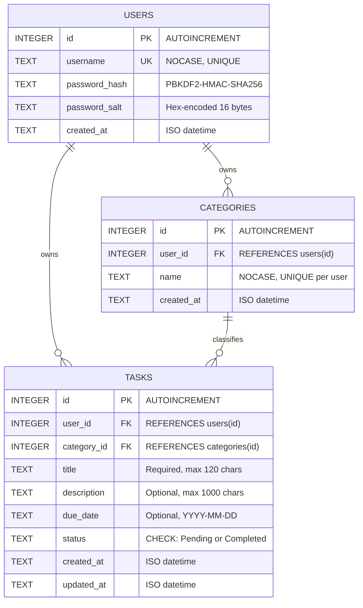

# Database Design Specification

## Task Management System

---

### 1. Database Overview

The Task Management System utilizes an embedded relational database engine—**SQLite 3**—stored locally at `database/task_manager.db`. The database is created automatically upon first execution and requires zero external database server administration (e.g., MySQL or PostgreSQL).

To ensure high data integrity, strict referential constraints, cascading deletes, and composite foreign keys are enforced by executing `PRAGMA foreign_keys = ON` on every connection opened by the application.

---

### 2. Entity-Relationship (ER) Diagram



---

### 3. Detailed Table Definitions

#### 3.1. Table: `users`

Stores user credentials and metadata.

| Field Name      | Data Type | Constraints                      | Description                                                 |
| --------------- | --------- | -------------------------------- | ----------------------------------------------------------- |
| `id`            | INTEGER   | PRIMARY KEY AUTOINCREMENT        | Unique identifier for each registered account.              |
| `username`      | TEXT      | NOT NULL, UNIQUE, COLLATE NOCASE | Alphanumeric account username (case-insensitive).           |
| `password_hash` | TEXT      | NOT NULL                         | Hex-encoded digest from PBKDF2-HMAC-SHA256.                 |
| `password_salt` | TEXT      | NOT NULL                         | Hex-encoded 16-byte random salt unique to each user.        |
| `created_at`    | TEXT      | NOT NULL                         | Timestamp when account was created (`YYYY-MM-DD HH:MM:SS`). |

#### 3.2. Table: `categories`

Stores task categories created by or provisioned for users.

| Field Name   | Data Type | Constraints                                   | Description                                 |
| ------------ | --------- | --------------------------------------------- | ------------------------------------------- |
| `id`         | INTEGER   | PRIMARY KEY AUTOINCREMENT                     | Unique identifier for the category.         |
| `user_id`    | INTEGER   | NOT NULL, FK to `users(id)` ON DELETE CASCADE | ID of the account owning this category.     |
| `name`       | TEXT      | NOT NULL, COLLATE NOCASE                      | Category name (e.g., "Education", "Work").  |
| `created_at` | TEXT      | NOT NULL                                      | Creation timestamp (`YYYY-MM-DD HH:MM:SS`). |

- **Table-Level Constraints:**
  - `UNIQUE (user_id, name COLLATE NOCASE)`: Prevents a single user from having duplicate category names, while allowing different users to each have categories with identical names.
  - `UNIQUE (id, user_id)`: Candidate key enabling the composite foreign key constraint from the `tasks` table.

#### 3.3. Table: `tasks`

Stores personal tasks created by users.

| Field Name    | Data Type | Constraints                                   | Description                                             |
| ------------- | --------- | --------------------------------------------- | ------------------------------------------------------- |
| `id`          | INTEGER   | PRIMARY KEY AUTOINCREMENT                     | Unique identifier for the task.                         |
| `user_id`     | INTEGER   | NOT NULL, FK to `users(id)` ON DELETE CASCADE | ID of the user owning the task.                         |
| `category_id` | INTEGER   | NOT NULL                                      | ID of the category assigned to the task.                |
| `title`       | TEXT      | NOT NULL                                      | Brief title describing the task.                        |
| `description` | TEXT      | NOT NULL DEFAULT ''                           | Detailed description or notes (optional).               |
| `due_date`    | TEXT      | NULLABLE                                      | Target completion date in ISO format (`YYYY-MM-DD`).    |
| `status`      | TEXT      | NOT NULL DEFAULT 'Pending', CHECK constraint  | Current task status: `'Pending'` or `'Completed'`.      |
| `created_at`  | TEXT      | NOT NULL                                      | Creation timestamp (`YYYY-MM-DD HH:MM:SS`).             |
| `updated_at`  | TEXT      | NOT NULL                                      | Timestamp of last modification (`YYYY-MM-DD HH:MM:SS`). |

- **Table-Level Constraints:**
  - `FOREIGN KEY (user_id) REFERENCES users(id) ON DELETE CASCADE`
  - `FOREIGN KEY (category_id, user_id) REFERENCES categories(id, user_id) ON DELETE RESTRICT`

---

### 4. Integrity Constraints & Referential Actions

#### 4.1. Composite Foreign Key for Cross-User Isolation

A critical vulnerability in multi-user systems is accidental or malicious association of User A's task with User B's category. In this application, this is prevented at the database engine level via a composite foreign key:

```sql
FOREIGN KEY (category_id, user_id) REFERENCES categories(id, user_id) ON DELETE RESTRICT
```

Because `categories` has a `UNIQUE(id, user_id)` constraint, SQLite rejects any task insertion where `tasks.category_id` and `tasks.user_id` do not correspond to an existing record in `categories` with the exact same `user_id`.

#### 4.2. Safe Category Deletion (`ON DELETE RESTRICT`)

Categories that currently classify one or more tasks cannot be deleted (`ON DELETE RESTRICT`). If a user attempts to delete a category in use, the application and database both block the operation, alerting the user to reassign or delete the associated tasks first.

#### 4.3. User Account Cascade (`ON DELETE CASCADE`)

If a user account is deleted, all associated categories and tasks are automatically removed, preventing orphaned records from remaining in the database.

---

### 5. Performance Indexes

The following indexes optimize frequent queries:

```sql
CREATE INDEX IF NOT EXISTS idx_tasks_user_id ON tasks(user_id);
CREATE INDEX IF NOT EXISTS idx_tasks_user_status ON tasks(user_id, status);
CREATE INDEX IF NOT EXISTS idx_tasks_user_category ON tasks(user_id, category_id);
CREATE INDEX IF NOT EXISTS idx_tasks_due_date ON tasks(user_id, due_date);
CREATE INDEX IF NOT EXISTS idx_categories_user ON categories(user_id);
```

---

### 6. Full Data Definition Language (DDL) Script

```sql
PRAGMA foreign_keys = ON;

-- 1. Users Table
CREATE TABLE IF NOT EXISTS users (
    id INTEGER PRIMARY KEY AUTOINCREMENT,
    username TEXT NOT NULL UNIQUE COLLATE NOCASE,
    password_hash TEXT NOT NULL,
    password_salt TEXT NOT NULL,
    created_at TEXT NOT NULL
);

-- 2. Categories Table
CREATE TABLE IF NOT EXISTS categories (
    id INTEGER PRIMARY KEY AUTOINCREMENT,
    user_id INTEGER NOT NULL,
    name TEXT NOT NULL COLLATE NOCASE,
    created_at TEXT NOT NULL,
    FOREIGN KEY (user_id) REFERENCES users(id) ON DELETE CASCADE,
    UNIQUE (user_id, name COLLATE NOCASE),
    UNIQUE (id, user_id)
);

-- 3. Tasks Table
CREATE TABLE IF NOT EXISTS tasks (
    id INTEGER PRIMARY KEY AUTOINCREMENT,
    user_id INTEGER NOT NULL,
    category_id INTEGER NOT NULL,
    title TEXT NOT NULL,
    description TEXT NOT NULL DEFAULT '',
    due_date TEXT,
    status TEXT NOT NULL DEFAULT 'Pending' CHECK (status IN ('Pending', 'Completed')),
    created_at TEXT NOT NULL,
    updated_at TEXT NOT NULL,
    FOREIGN KEY (user_id) REFERENCES users(id) ON DELETE CASCADE,
    FOREIGN KEY (category_id, user_id) REFERENCES categories(id, user_id) ON DELETE RESTRICT
);
```

---

### 7. Explanation of User Ownership

Every table containing personal information maintains a `user_id` column linked to `users.id`.

- The presentation layer obtains `user_id` exclusively from the verified session object in memory (`app.current_user["id"]`).
- No business logic function or SQL query relies on client-supplied parameters without binding `WHERE user_id = ?`.
- Even if a malicious actor attempts to pass arbitrary task IDs, queries scoped to `user_id` will return `None`, preventing unauthorized reads, updates, or deletions.
