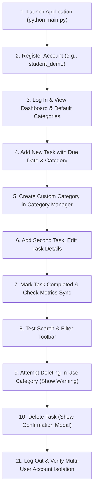

# Final Project Presentation and Demonstration Outline

## Task Management System — Viva & Demo Guide

This outline is designed to assist you during your university individual project viva and live demonstration. It covers key talking points, architecture highlights, security features, and a timed demonstration flow.

---

### Slide / Topic 1: Project Introduction

- **Project Title:** Task Management System
- **Developer:** [Your Name / Student ID]
- **Type:** 3rd Year Undergraduate Individual Software Development Project
- **Application Type:** Desktop GUI Application (Windows)
- **Core Concept:** A secure, local, multi-user personal productivity application designed for managing personal tasks, deadlines, and categories with zero cloud dependencies.

---

### Slide / Topic 2: Problem Statement

- Many students and professionals manage tasks across disorganized notes, spreadsheets, or third-party web apps.
- Unstructured methods lack date validation, status metrics, and categorization.
- Cloud tools often introduce privacy risks, require internet access, or consume excessive system memory.
- **Solution:** A self-contained, offline desktop application providing robust data persistence, validated workflows, and clear metrics.

---

### Slide / Topic 3: Project Objectives

1. Implement secure authentication using industry-standard salted password hashing.
2. Deliver complete CRUD functionality for tasks with ISO date validation.
3. Provide customizable task categorization with safe deletion protections.
4. Enforce referential integrity in SQLite through foreign keys and composite constraints.
5. Provide real-time dashboard analytics with interactive search and filtering.
6. Build a complete automated test suite achieving 100% standard library compatibility.

---

### Slide / Topic 4: Technology Stack

- **Programming Language:** Python 3 (3.10+)
- **GUI Framework:** Tkinter and ttk (themed standard widgets)
- **Database Engine:** SQLite 3 (embedded relational database)
- **Security:** `hashlib.pbkdf2_hmac` (SHA-256 with 120,000 iterations and per-user salts)
- **Path & Date Management:** `pathlib` and `datetime`
- **Testing:** `unittest` framework (42 automated test cases)
- **External Dependencies:** None (100% Python Standard Library).

---

### Slide / Topic 5: System Architecture

- **Layered Design Pattern:**
  - `ui.py`: Desktop presentation layer (frames, treeviews, modal dialogs).
  - `auth.py`: Session management and password security.
  - `task_manager.py`: Core task business logic and analytics.
  - `category_manager.py`: User-scoped category logic and deletion guards.
  - `validators.py`: Stateless input validation rules.
  - `database.py`: SQLite connection lifecycle and schema DDL.
  - `config.py`: Centralized configuration constants and styling palette.

---

### Slide / Topic 6: Database Architecture & Integrity

- **Normalized Tables:**
  - `users`: ID, username, password hash, random salt, creation timestamp.
  - `categories`: ID, user_id, category name, creation timestamp.
  - `tasks`: ID, user_id, category_id, title, description, due date, status, timestamps.
- **Key Constraints:**
  - `PRAGMA foreign_keys = ON` on every connection.
  - Cascading deletion for users (`ON DELETE CASCADE`).
  - Restrict deletion for categories with active tasks (`ON DELETE RESTRICT`).
  - Composite candidate key `UNIQUE(id, user_id)` and composite foreign key `FOREIGN KEY(category_id, user_id) REFERENCES categories(id, user_id)` preventing cross-user category assignments.

---

### Slide / Topic 7: Authentication & Security

- **Salted Hashing:** Unique 16-byte random salt per user prevents rainbow table attacks.
- **Constant-Time Verification:** `hmac.compare_digest` mitigates timing side-channel attacks.
- **No Plaintext Passwords:** Hashes and salts are stored as hex strings; passwords are never logged.
- **SQL Injection Defense:** All queries utilize parameterized markers (`?`).
- **Session Privacy:** Account sessions exist only in volatile process memory.

---

### Slide / Topic 8: Task CRUD & Categorization

- **Task Lifecycle:** New tasks start as `'Pending'`. Tasks can be edited or marked `'Completed'`.
- **Default Categories:** Automatic creation of "Education", "Work", "Personal", and "Other" on registration.
- **Custom Categories:** Users can add unique custom categories at any time.
- **Safe Category Deletion:** System inspects task count before deletion, blocking removal if tasks depend on the category.

---

### Slide / Topic 9: Search, Filtering, and Dashboard Metrics

- **Interactive Search:** Case-insensitive substring query on task titles.
- **Multi-Filter Combination:** Filter by category and status (All / Pending / Completed) simultaneously.
- **Real-Time Metrics:** Live updates for Total Tasks, Pending Tasks, Completed Tasks, Overdue Tasks, and Completion Rate.

---

### Slide / Topic 10: Testing & Verification

- **Automated Test Suite:**
  - `test_database.py`: 5 tests (DDL, pragmas, cascading, composite keys).
  - `test_auth.py`: 10 tests (registration, login, invalid credentials, hash uniqueness).
  - `test_categories.py`: 9 tests (defaults, uniqueness, isolation, safe deletion).
  - `test_tasks.py`: 13 tests (CRUD, completion, ISO dates, isolation, metrics).
  - `test_gui.py`: 5 integration tests (Tkinter initialization, treeview sync, filter events).
- **Result:** 42 out of 42 tests passing with zero errors.

---

### Slide / Topic 11: Live Demonstration Flow (5-Minute Viva Demo)

1. **Launch:** Run `python main.py` in PowerShell. Point out clean centered login window.
2. **Registration:** Register user `student_demo`. Highlight the feedback dialog confirming account and default categories.
3. **Login:** Sign in with `student_demo`. Show header with user badge and 4 summary cards.
4. **Task Creation:** Click "+ New Task", enter "Complete Final SRS Document", select "Education", pick tomorrow's date using the quick button, save. Point out table row and metric update.
5. **Custom Category:** Open Category Manager, add "Capstone Project". Show it appears immediately in the table.
6. **Completion:** Select task, click "✔ Mark Completed". Note status change to "✅ Completed" and metric increment.
7. **Safe Category Deletion:** In Category Manager, try deleting "Education". Explain the warning dialog protecting referential integrity.
8. **Persistence Demonstration:** Close the app, reopen with `python main.py`, and sign back in to prove persistent storage in SQLite.
9. **Isolation Demonstration:** Log out and log in with a second account to show 0 tasks and strict privacy isolation.

---

### Slide / Topic 12: Limitations and Future Improvements

- **Current Limitations:**
  - Local desktop focus; no real-time cross-device network synchronization.
  - Single-user concurrent desktop session.
- **Future Enhancements:**
  - Desktop system-tray notifications for upcoming deadlines.
  - Exporting tasks to CSV or PDF summary reports.
  - Calendar monthly grid view option.
